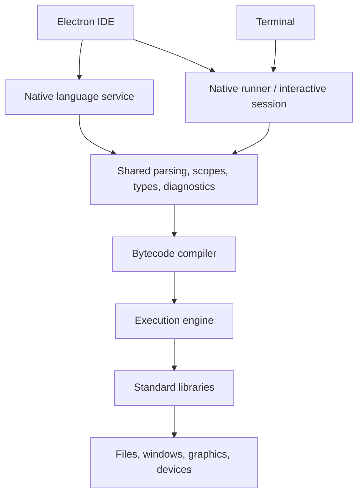

# SLANG product and implementation roadmap

Status: version 0.6 includes the native C++20 interpreter, REPL, libraries, SDL graphics, and an Electron/Monaco IDE with offline completion, canvas/console panels, and basic debugging. Windows x64 is verified locally. The bytecode engine, full static type inference, advanced language services, and cross-platform release qualification remain future work. See [IDE guide](ide.md), [runtime rules](runtime.md), [module rules](modules.md), and [graphics](graphics.md).

## Product experience

SLANG should combine the integrated edit/build/run experience of Turbo Pascal with Python-style interactive exploration. A student should be able to open the application, write a program, run it, inspect values, and experiment in a console. The CLI must also work independently of the IDE.

Required product components:

- A compiler with useful source diagnostics.
- An interactive interpreter with persistent session state and multiline input.
- An IDE with syntax highlighting, ordinary code completion, signature help, and diagnostics.
- A standard library for collections, console I/O, files, graphics, plotting, audio, and eventually IoT/device communication.
- English and Norwegian language support based on the same language semantics.
- A complete distribution for supported Windows, macOS, and Linux systems.

Code completion is explicitly **not AI-based**. It must derive suggestions from syntax, visible declarations, inferred types, object fields, callable signatures, and library metadata. Local documentation and deterministic snippets are appropriate. Core programming and learning features must work offline.

## Complete distribution contract

The finished distributable must contain everything required to use the shipped features. The user should only need to extract the archive into a folder or run the installer. There must be no prerequisite-installation checklist and no first-launch dependency download.

Every supported platform/architecture package must include:

- The IDE and its Electron dependencies.
- The native SLANG CLI, compiler, execution engine, and language service.
- Standard libraries and required redistributable native dependencies.
- Library metadata and help used by completion, signatures, and diagnostics.
- Examples and offline teaching/reference material.
- Fonts, icons, and other assets needed by shipped functionality.
- Launchers that locate these components relative to the installation or extracted folder.

Students must not need to install Node.js, .NET, Python, a C++ compiler, a package manager, or editor plugins separately. Any compiler/linker support needed by a future build mode must either be included or avoided by the packaging architecture. Development-machine prerequisites are separate from end-user requirements.

The portable package must not depend on a global PATH change, a fixed installation path, or administrative installation. The IDE and CLI must locate shipped resources correctly in paths containing spaces and Scandinavian letters. User projects and settings must have a suitable writable location when the application itself is installed in a read-only directory.

Packages are platform-specific, not one universal executable. Define and test supported OS versions and CPU architectures. OS facilities, graphics drivers, and physical devices remain platform prerequisites; third-party redistributable dependencies required by SLANG must be included where applicable. Portable and installer packaging must account for each platform's application layout and launch requirements.

IoT examples requiring particular hardware must identify that hardware clearly. General libraries, examples, and documentation are bundled; universal support for arbitrary devices and their vendor drivers is not implied. Normal device access permissions remain OS-managed.

Release acceptance must include clean machines without development runtimes, offline first launch, CLI operation, interactive execution, completion, opening examples, and running shipped graphical demos. Extraction/installation and launching must be tested on each claimed target. If a standalone program export feature is shipped, its output must also run without the IDE or a separately installed SLANG runtime.

## Architecture

The native C++20 core owns language semantics. The Electron IDE is a client of that core, rather than a second implementation of the language.

Use a separate native process for program execution so an infinite loop or program failure does not block the editor UI. Design a stop/reset control for interactive sessions. IDE diagnostics and completion should use the same frontend as the CLI, including support for incomplete source while a student is typing.

The language service should use the Language Server Protocol where practical, allowing completion and navigation to be reused by other editors. Execution control and debugging require a separate interface; LSP alone is not a debugger. A debugger protocol can be selected once stepping and variable inspection exist in the engine.

Electron includes Chromium and Node.js in the IDE distribution. Students do not install them separately. The CLI and exported SLANG applications must not depend on Electron. Electron's distribution size is an accepted IDE tradeoff, not a requirement imposed on every SLANG program.

## Compiler and interpreter

The production direction remains SLANG bytecode and a native execution engine. Version 0.3 first supplies an AST interpreter to establish runnable semantics and tests. File execution and the REPL already share the same name validation, evaluator, arithmetic, types, and heap. The bytecode engine should preserve these tested behaviors while improving performance and collection during execution.

A future standalone export can combine bytecode, required assets/libraries, and the native engine into an application. This must be distinguished from ahead-of-time compilation of SLANG expressions into machine code, which is a separate future backend decision.

CLI status:

| Command | Purpose |
| --- | --- |
| `slang repl` | Implemented: persistent interactive session |
| `slang check program.slang` | Implemented: syntax only; static semantic checking remains planned |
| `slang run program.slang` | Implemented: validate names/control flow and interpret with runtime type checks |
| `slang build program.slang` | Planned: produce a runnable artifact |

With no arguments, `slang` opens the console. The build artifact format remains open.

REPL requirements:

- Retain declarations, functions, and values between successful submissions.
- Accept multiline blocks through their closing period without imposing indentation rules.
- Display expression results and support inspecting their inferred types.
- Preserve strong typing; interactive use must not silently introduce JavaScript-like coercions.
- Keep a failed compilation from changing session state.
- Explain runtime failures without promising rollback of effects already performed.
- Support reset and interruption.

Decide how declaration replacement works in an interactive session. If intentional redefinition is supported, it must be an explicit REPL policy rather than an accidental change to file semantics. Whole-file execution should start from a fresh state by default so results do not depend on previous console experiments.

## IDE scope

Version 0.6 implements the Electron IDE with a Monaco editor, syntax highlighting, deterministic completion, a file browser, resizable canvas and console panels, linked diagnostics, and obvious **Run, Stop, Pause, and Debug** controls. The native runner supplies actual pause/resume, statement breakpoints, step-into, and visible variable summaries. See [current features and limits](ide.md).

Completion should include:

- Keywords in the selected teaching language.
- Variables and functions visible in the current lexical scope.
- Declared/inferred object fields after member access.
- Function signatures and argument information for angle-delimited calls.
- Imported library names and documentation.

Syntax highlighting can begin lexically, with semantic highlighting supplied by the language service when available. Matching block periods and call delimiters is particularly important. Automatic indentation is presentation support, not language semantics.

The initial completion service scans declarations in the editor; syntax diagnostics come from the native frontend. A native semantic language service, LSP, step-over/out, call-stack views, and richer variable inspection remain future work. No AI completion, model service, or cloud account is required.

## Standard libraries

Libraries ship with the product and are accessed through ordinary language mechanisms. Drawing, opening a window, reading a file, or accessing a device must not require a new grammar construct. Version 0.4 implements `lib name:` blocks, explicit `public` exports, private-by-default declarations, relative source imports, shared initialization, cycle diagnostics, and bundled `console`/`numbers` namespaces. See [module rules](modules.md). The initial native registry still needs signature metadata for editor tooling and future library extension. Inheritance and object-member visibility remain deferred.

The initial student library set now includes text operations, list copying/sorting, exact numeric helpers and statistics, seeded randomness, interruptible timing, and UTF-8 file I/O, with IDE signatures and runnable classroom examples. See the [standard library reference](standard-library.md). Full Unicode casing/collation, structured data formats, directory APIs, and calendar dates remain future work.

Delivery areas:

1. Console I/O, collections, text operations, and foundational numeric helpers.
2. Files, paths, timing, and common data formats.
3. Windows, drawing, input, images, audio, and plotting.
4. Simple application widgets and layouts as needed by classroom examples.
5. Serial/network communication and selected IoT/device integrations.

SDL is the integrated graphics backend. Keep the SLANG-facing API independent of backend naming. Treat plotting and widgets as additional library work, not capabilities automatically supplied by a game-rendering backend.

The initial `window` library now provides seven basic controls, automatic vertical layout, button callbacks, Unicode text entry, and keyboard navigation using the same native/IDE canvas. See [window support and limitations](windows.md). Multiple windows, custom layouts, OS accessibility integration, dialogs, and richer input editing remain future work.

### Graphics status and next work

Version 0.5 implements the SDL backend, implicit retained canvas, ordinary frame loops, function callbacks (including closures), shapes, keyboard snapshots, cached PNG/BMP sprites, PNG export, pacing, and cleanup. See [graphics rules and examples](graphics.md) for the shipped API. Static drawings remain visible until closed, and the REPL can add to its canvas. Console output remains available alongside graphics.

Sustained 60 FPS for modest 2D sprite games is an acceptance target, not a universal performance claim. The included 120-sprite benchmark measures a 960 by 540 scene for 300 frames; representative classroom hardware and richer game-update workloads still need testing. Rendering is native and accelerated where available. Heavy 3D workloads remain deferred.

The interpreter now collects during execution using explicit evaluator roots. Presented frames renew its execution budget while stuck updates retain a limit; events and cancellation are serviced between interpreted operations. Continue profiling before deciding whether bytecode must precede more advanced game features. Preserve arbitrary integers and decimal arithmetic; bounded rendering-coordinate conversion belongs at the native library boundary.

Version 0.6 embeds frames from the SDL renderer in the IDE and forwards keyboard events to it. Next graphics work includes plotting with automatic axes, text/fonts, and mouse input.

Initial IoT work should mean communicating with devices from a desktop host. Running the full SLANG engine directly on constrained microcontrollers is a separate target and feasibility decision.

## Delivery stages

1. **Native frontend (initial milestone implemented):** C++20 builds, source diagnostics, examples and syntax tests, English/Norwegian equivalence, and exact numeric literal spelling. Windows x64 has been verified locally; macOS/Linux verification and resolving the remaining grammar ambiguities are still required.
2. **Semantic analysis (partial):** name/scope and control-flow validation are implemented; types and overloads are checked at runtime. Complete static inference and review the initial semantic choices.
3. **Execution and CLI (interpreter implemented):** runtime values, collection during execution, closures, basic I/O, file execution, SDL graphics loops/callbacks, and a persistent REPL work. Bytecode and further performance work remain.
4. **Language services and IDE (initial milestone implemented):** non-AI completion, signatures, native syntax diagnostics, highlighting, run/stop/pause/debug, integrated console and SDL canvas, and offline help. Native semantic services and advanced debugging remain.
5. **Standard libraries:** deliver the staged APIs with small, complete classroom examples.
6. **Complete releases:** build and test extractable/installable distributions on clean supported Windows, macOS, and Linux systems. Add standalone program export when its dependency handling is ready.

Packaging feasibility should be checked early in native development and continuously, rather than postponed until the final milestone. Each release must distinguish implemented features from planned ones.

## Reference documentation

- [Electron introduction](https://www.electronjs.org/docs/latest): Electron embeds Chromium and Node.js for Windows, macOS, and Linux applications.
- [Electron process model](https://www.electronjs.org/docs/latest/tutorial/process-model): main and renderer process responsibilities.
- [Language Server Protocol](https://microsoft.github.io/language-server-protocol/): shared editor services such as completion and navigation.

These references describe enabling technology. They do not establish that SLANG has implemented the architecture above.
